# World Model Foundation — Conceptual Design

**Project:** RPG — Adventurer Academy / Fantasy Life Simulation  
**Engine:** Godot 4.7.2 .NET / C#  
**Status:** Working proposal — not an implementation specification  
**Branch:** `docs/world-model-foundation`

> This document records the current modeling direction so the world and gameplay can be designed incrementally. Names, relationships and examples below are provisional until reviewed. Do not treat this ERD as a finalized database schema or assume these systems already exist in code.

## 1. Design Goal

Model a reusable game world that can support academy life, towns, wilderness, ruins, dungeons, varied characters, creatures, activities and encounters.

The architecture must not be organized around one location type (such as Dungeon), one enemy (such as Goblin), or one gameplay loop. Prefer a small number of reusable concepts with specialized rules where they are genuinely needed.

The immediate task is **domain modeling**, not adding systems or writing code. We will validate each concept against concrete gameplay scenarios before committing to implementation.

## 2. Normalize the Vocabulary

Do not place these terms in one flat list. They describe different levels of the game.

| Concept | Meaning | Example |
|---|---|---|
| Gameplay Domain | Broad area of player experience; a classification, not automatically a system | Daily Life, Study, Social, Exploration, Combat, Economy, Investigation |
| Activity | A goal-oriented piece of work that may consist of multiple actions | Eat breakfast, Attend class, Train swordsmanship, Investigate a disappearance |
| Action | A concrete operation selected or performed by an actor | Eat, Drink, Sleep, Read, Walk, Attack, Dodge, Talk |
| Effect | A result that changes something | Restore health, consume an item, reveal a clue, change relationship |
| State | The current condition of an entity or the world | Health, hunger, inventory quantity, NPC disposition, door unlocked |

A Domain is a taxonomy. An Activity is a useful grouping or player-facing task. An Action is an executable operation. An Effect describes a change. State stores the resulting condition.

Not every Activity needs its own class or runtime object. Not every Action belongs to exactly one Domain. For example, Eat can be used at the academy, in a town, or while camping in the wilderness.

### Example: daily life

“Daily Life” is not necessarily a separate system. It is a domain containing activities such as eating, sleeping, personal care and relaxation.

An activity such as **Eat breakfast** may involve selecting food, consuming it and applying effects. The same Eat action can be reused in other contexts. The location or context may change available options and consequences, but should not duplicate the action definition without a real rules difference.

## 3. Initial Gameplay Inventory

This inventory is a coverage checklist, not a commitment to implement every item.

| Domain | Activities | Example Actions |
|---|---|---|
| Daily Life | Meals, hydration, sleep, rest, personal care, self-treatment | Eat, Drink, Cook, Sleep, Rest, Relax, Bathe, Wash, Groom, Take Medicine |
| Study & Growth | Classes, self-study, research, practical training | Attend Class, Listen, Take Notes, Read, Study, Research, Practice, Train, Spar |
| Social | Conversation, relationship building, helping, invitations, recruitment | Talk, Ask, Listen, Give Gift, Invite, Help, Recruit, Negotiate |
| Exploration | Travel, observation, searching, tracking, gathering, field survival | Walk, Run, Travel, Climb, Inspect, Search, Track, Gather, Harvest, Mine, Camp, Light Fire |
| Combat | Offensive, defensive, tactical and support operations | Attack, Cast Spell, Defend, Dodge, Parry, Use Item, Heal, Buff |
| Economy | Trading, crafting, maintenance, property management | Buy, Sell, Trade, Craft, Cook, Repair, Equip, Store |
| Investigation | Questioning, evidence collection, analysis and resolution | Question, Examine, Collect Evidence, Compare Clues, Deduce, Report, Accuse, Reveal |

Some words can appear in multiple domains because domains classify player experience rather than own unique actions. For example, Cook may be part of daily life or crafting; its context and rules determine which use applies.

## 4. Object Inventory and Terminology

### 4.1 Characters and roles

| Concept | Proposed meaning |
|---|---|
| Character | A living individual with attributes and state |
| Player | The character currently controlled by the user |
| NPC | A character controlled by game logic |
| Enemy | A character participating as a hostile opponent in a context |
| Companion | A character currently accompanying or assisting the player |
| Creature | A non-human living entity |

**Current decision:** Do not introduce a general-purpose `Actor` base concept yet. Model living participants as `Character`. Treat Player, NPC, Enemy and Companion as roles or contextual relationships rather than automatically creating separate entity types. A character might be an NPC in one context, an enemy in another, and later become a companion.

Non-living world objects are modeled separately where needed. An object such as a door, chest, trap or altar may expose interaction rules, but it does not need to inherit from Character or Actor. Use an Interactable capability only where an object genuinely supports player interaction.

### 4.2 World and places

| Concept | Proposed meaning |
|---|---|
| World | The overall simulation context |
| Location | A place in the world where characters and objects can be present; locations may contain smaller locations |
| Location Presence | The fact that a character or object is currently present at a location |
| Interaction Context | The object or entity the player is currently interacting with, without necessarily changing location |

**Current direction:** Do not introduce Area as a required core entity. Represent places with a Location hierarchy using an optional `parent_location_id`. For example, Haunted House can contain Main Hall, Bedroom Floor 2 and Basement; Basement can contain Storage Room. The player's current Location remains the specific place they occupy.

Containment and navigation are different ideas. A child Location is part of its parent, but that does not by itself define every possible route. For the current text-based prototype, movement can be represented by an Action whose Target identifies the destination and whose Effect changes the current Location. A separate Location Connection model is not required yet; reconsider it only if routes need independent querying, shared conditions or map/path functionality.

An object such as a Mirror or Bed is not a Location. Interacting with it can change the Interaction Context while the player remains in the same Location.

### 4.3 Objects and possessions

| Concept | Proposed meaning |
|---|---|
| Interactable | An object or entity that can expose interactions |
| Item | A defined object that can be owned, consumed, equipped, traded or used |
| Equipment | An item that can occupy an equipment slot and provide rules or effects |
| Resource | A material or collectible quantity used by other activities |
| Inventory | A container/ownership collection |
| Container | A world object that can hold items, such as a chest or storage box |

Equipment and Resource may be item categories or capabilities rather than independent inheritance branches. Decide after examining their shared fields and behavior.

### 4.4 Situations, information and progression

| Concept | Proposed meaning |
|---|---|
| Encounter | A situation requiring the player or participants to respond |
| Combat | A specialized encounter with turn, targeting and combat-resolution rules |
| Dialogue | A conversation interaction/flow; not automatically an Encounter |
| Event | Something that happened in the simulation and may be recorded or trigger reactions |
| Knowledge | Information known by an actor or available to the player |
| Clue | A specific piece of evidence or information |
| Quest | A goal or chain of objectives |
| Relationship | A directed or mutual social state between actors |
| World State | Shared facts about the world, locations, factions or other entities |

Encounter and Event are not synonyms. A trap activation may be an event; being caught in a trap that requires a response may create an encounter. A conversation can be an ordinary interaction or a more structured situation depending on its rules.

## 5. Effects and State Ownership

Effects describe changes; state belongs to the entity or relationship being changed.

Examples:

- Eating may consume an Item, reduce Hunger and advance time.
- Sleeping may advance time and change recovery-related character state.
- Training may change skill progression and fatigue.
- Defeating a creature may change its life state, grant rewards, alter a local threat and emit an event.
- Discovering a clue may add Knowledge and update an Investigation or Quest objective.

Do not create a separate state system for every activity. First identify the owner of each state:

- Character state: health, fatigue/energy, mood, needs, attributes, skills.
- Location state: discovered, blocked, damaged, resources remaining, local conditions.
- Item state: quantity, durability, ownership, equipped status.
- Relationship state: trust, affinity, hostility or other agreed dimensions.
- World state: persistent facts shared across locations and systems.
- Encounter state: participants, phase, outcome and encounter-specific variables.

These are candidate categories. Exact state fields and whether some belong together remain open.

## 6. Conceptual ERD (Provisional)

This diagram illustrates candidate entities and relationships only. It is not a normalized physical database schema. In particular, polymorphic references, state storage, action targets and effect payloads need further design before implementation.

```mermaid
erDiagram
    WORLD ||--o{ LOCATION : contains
    LOCATION o|--o{ LOCATION : contains
    LOCATION ||--o{ LOCATION_PRESENCE : records

    CHARACTER ||--o{ LOCATION_PRESENCE : appears_at
    CHARACTER ||--o{ ACTION_EXECUTION : performs
    ACTION_DEFINITION ||--o{ ACTION_EXECUTION : defines
    ACTION_EXECUTION o|--o| ACTION_TARGET : may_target
    ACTION_EXECUTION o|--o| ACTION_SOURCE : may_use
    ACTION_EXECUTION ||--o{ ACTION_EFFECT : produces

    CHARACTER ||--o{ INVENTORY : owns
    INVENTORY ||--o{ INVENTORY_ITEM : contains
    ITEM_DEFINITION ||--o{ INVENTORY_ITEM : identifies

    CHARACTER ||--o{ RELATIONSHIP : participant
    CHARACTER ||--o{ RELATIONSHIP : counterpart

    LOCATION ||--o{ ENCOUNTER : hosts
    ENCOUNTER ||--o{ ENCOUNTER_PARTICIPANT : includes
    CHARACTER ||--o{ ENCOUNTER_PARTICIPANT : participates

    CHARACTER ||--o{ KNOWLEDGE : holds
    KNOWLEDGE ||--o{ CLUE : includes

    QUEST ||--o{ QUEST_OBJECTIVE : defines
    CHARACTER ||--o{ QUEST_PROGRESS : tracks
    QUEST ||--o{ QUEST_PROGRESS : progresses

    WORLD ||--o{ WORLD_EVENT : records
    WORLD ||--o{ WORLD_STATE : maintains

    WORLD {
        string id PK
    }
    LOCATION {
        string id PK
        string world_id FK
        string parent_location_id FK
        string name
    }
    LOCATION_PRESENCE {
        string id PK
        string location_id FK
        string entity_ref
        string entity_kind
    }
    CHARACTER {
        string id PK
        string name
        string role
    }
    ACTION_DEFINITION {
        string id PK
        string owner_kind
        string owner_ref
        string name
    }
    ACTION_EXECUTION {
        string id PK
        string action_id FK
        string performer_id FK
        string target_ref
        string source_ref
    }
    ACTION_TARGET {
        string id PK
        string target_kind
        string target_ref
    }
    ACTION_SOURCE {
        string id PK
        string source_kind
        string source_ref
    }
    ACTION_EFFECT {
        string id PK
        string execution_id FK
        string effect_type
    }
    ITEM_DEFINITION {
        string id PK
        string name
        string category
    }
    INVENTORY {
        string id PK
        string owner_character_id FK
    }
    INVENTORY_ITEM {
        string inventory_id FK
        string item_id FK
        int quantity
    }
    RELATIONSHIP {
        string character_a_id FK
        string character_b_id FK
        string relationship_type
    }
    ENCOUNTER {
        string id PK
        string location_id FK
        string encounter_type
        string status
    }
    ENCOUNTER_PARTICIPANT {
        string encounter_id FK
        string character_id FK
    }
    KNOWLEDGE {
        string id PK
        string character_id FK
        string subject_ref
    }
    CLUE {
        string id PK
        string knowledge_id FK
    }
    QUEST {
        string id PK
        string name
    }
    QUEST_OBJECTIVE {
        string id PK
        string quest_id FK
    }
    QUEST_PROGRESS {
        string character_id FK
        string quest_id FK
        string status
    }
    WORLD_STATE {
        string id PK
        string world_id FK
        string state_key
    }
    WORLD_EVENT {
        string id PK
        string world_id FK
        string event_type
    }
```

### ERD caveats to resolve

1. `LOCATION_PRESENCE`: characters and non-living objects may need different typed relations; avoid an unvalidated generic entity reference in the final schema.
2. `ACTION_DEFINITION.owner_kind / owner_ref`: the provider of an Action is distinct from its Performer. A Location, Object or Character may provide an Action; the Player may still be the Performer.
3. `ACTION_EXECUTION`: Performer is required; Target and Source are optional and may be null. Target and Source can refer to different kinds of domain objects.
4. `ACTION_EFFECT`: an execution may produce zero or more effects. Effects should be structured domain operations, not arbitrary executable code in content data.
5. `WORLD_STATE`: determine which facts belong to World, Location, Character or a relationship before selecting storage.
6. `KNOWLEDGE` / `CLUE`: distinguish raw evidence, discovered facts, and what the player-character actually knows.
7. `ENCOUNTER`: specialized encounter types may own their own state and rules; do not force all behavior into one generic table.

## 7. Modeling Rules

- A gameplay category does not automatically imply a software System.
- An Activity is not necessarily an executable Action.
- Reuse Actions across domains and locations when their rules are the same.
- A role such as Player, NPC, Enemy or Companion should not automatically become a separate entity type.
- Do not introduce a general Actor abstraction until concrete shared behavior requires it; use Character for living participants and model interactable objects separately.
- An Action is provided/owned by a Character, Location or Object; its provider is not necessarily its Performer.
- Action Execution records a required Performer, an optional Target, an optional Source and zero or more Effects. A null Target or Source is a valid case, not an execution error.
- Effects declare requested domain changes. The responsible System validates and applies the Effect; Action execution coordinates the process rather than embedding every System's rules.
- For the current prototype, use a shared Action execution pipeline: Request → Handle → Orchestrator → Guard/Validator → Effects → responsible Systems → Apply → updated State.
- Request is a distinct responsibility in the user's 13-responsibility code organization: it creates/packages/sends an instruction to the application boundary. Handle receives and routes it. Request may involve a request data object and a sender; it is not necessarily one function.
- Validate required conditions before applying changes. Multi-Effect atomicity, rollback and partial-failure handling remain implementation questions.
- Combat remains specialized; do not flatten its turn and resolution rules into generic Action processing.
- Effects change state; Events record or announce what happened.
- JSON/content data describes definitions and configuration. C# owns executable rules and validation.
- Do not put arbitrary code or formulas in JSON.
- Add a dedicated System only when there is a distinct responsibility and rules that justify it.
- Validate the model against multiple locations, actor types and gameplay situations before implementation.

## 8. Incremental Modeling Plan

We will review and revise one area at a time. Each step should produce a decision record, updated diagrams and a list of unresolved questions.

| Step | Scope | Validation scenario | Exit condition |
|---|---|---|---|
| 1 | Character and roles | Player, student NPC, hostile creature, recruitable companion | Character and contextual roles are clear; Actor abstraction is justified or omitted |
| 2 | World, Location hierarchy and interaction context | Academy, town, forest, multi-room haunted house, mirror and bed interactions | Containment, current location and interaction context are distinct |
| 3 | Activity, Action ownership and Action Execution | Eat breakfast, sleep, use potion, self-buff, give gift, travel, inspect mirror | Provider, Performer, optional Target/Source and zero-or-more Effects are clear |
| 4 | State, Effect and Event | Eat, train, defeat enemy, reveal clue, change location, start interaction | State ownership, Effect dispatch and mutation flow are unambiguous |
| 5 | Encounter | Combat, trap, chase, negotiation, discovery | Shared lifecycle is identified without erasing specialized rules |
| 6 | Items and inventory | Food, potion, weapon, quest evidence, raw material | Ownership, use, equipment and consumption are clear |
| 7 | Relationships and knowledge | Recruit NPC, learn monster weakness, gather evidence | Information and social state are modeled independently |
| 8 | Quest and progression | Multi-step investigation and academy assignment | Objectives can react to events and state changes |

### Working method

For each step:

1. List real gameplay examples and edge cases.
2. Identify entities, attributes, ownership and relationships.
3. Mark concepts as **accepted**, **proposed**, or **unresolved**.
4. Update the ERD only when the relationships are understood.
5. Check whether the existing code already covers the concept.
6. Decide whether code changes are needed; do not implement speculatively.

## 9. Current Decisions vs. Open Questions

### Current direction

- The game supports multiple kinds of places and activities, not only dungeons and combat.
- Location-based navigation is the current prototype direction; free-roam movement is not required.
- Location is hierarchical; Area is not currently part of the core model.
- Action providers can be Locations, Objects or Characters; the Performer is the entity that actually executes the Action.
- Actions are concrete operations; Effects declare requested changes and responsible Systems resolve and apply them.
- Combat has specialized rules and presentation.
- Content definitions and executable rules remain separated.

### Open questions

- Which non-living objects need interaction capabilities, and how should those be represented without a universal Actor base?
- Are Activity and Action both runtime concepts, or is Activity only a grouping/presentation concept?
- Which character needs are simulated: Hunger, Thirst, Fatigue, Mood, Health or others?
- Does the player need to track both a current Location and a current Interaction Context, and what transitions clear or restore that context?
- How are interactable non-living objects represented without turning every object into a Location?
- What is the boundary between Encounter, Dialogue and Event?
- How is world state represented without creating one universal untyped state bag?
- How are optional Action Targets and Sources represented safely, including null cases, and how are Effects typed, validated and dispatched?
- What consistency/atomicity guarantees are required when an Action produces multiple Effects and one fails?

## 10. Implementation Status

This document is a design proposal. It does not claim that the listed entities, relationships, gameplay domains or systems are implemented.

The current prototype still has its existing Academy/Goblin vertical slice and Energy-based character model. The proposed broader world model and any future Fatigue/AP redesign must be treated as design work until separately implemented and tested.
